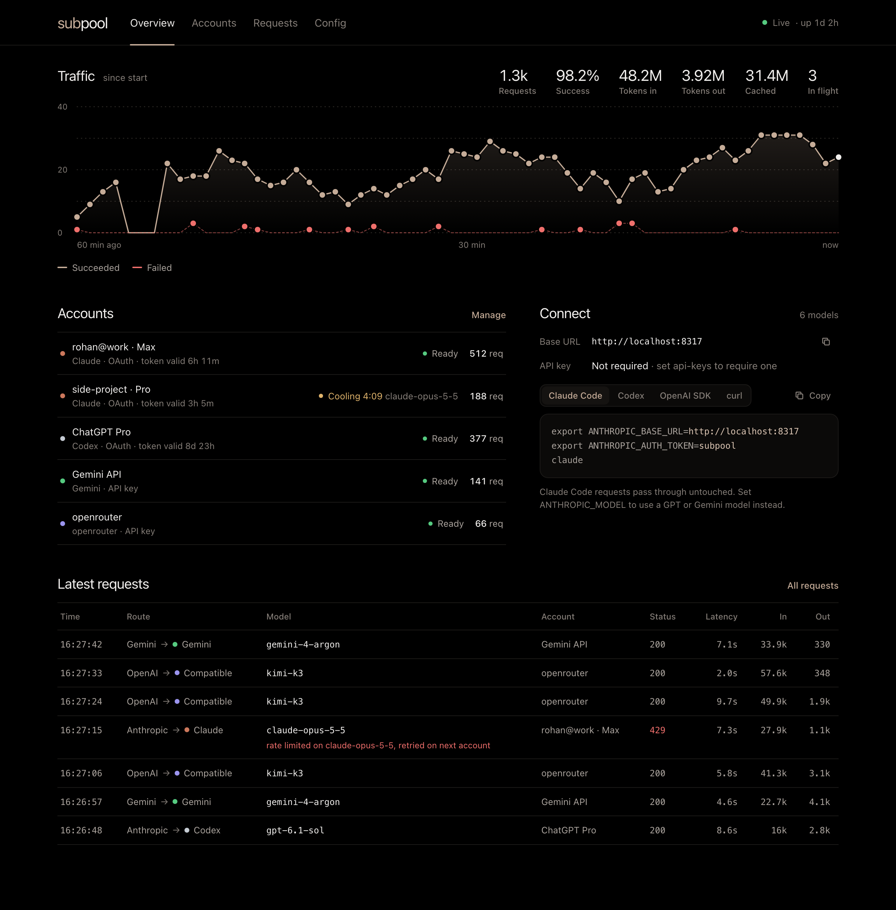
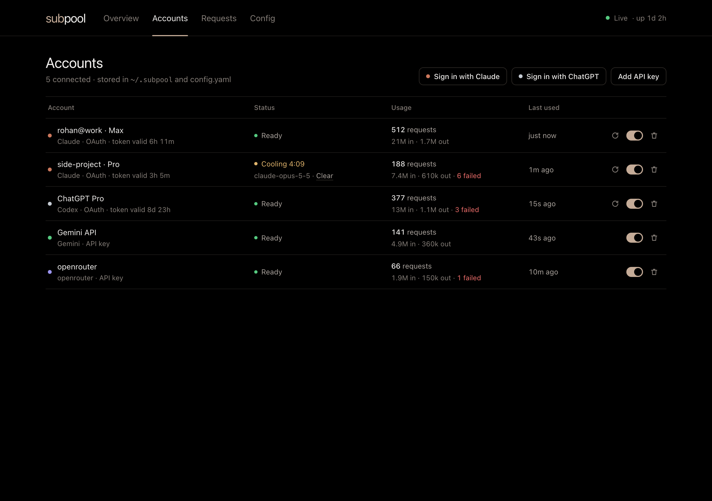
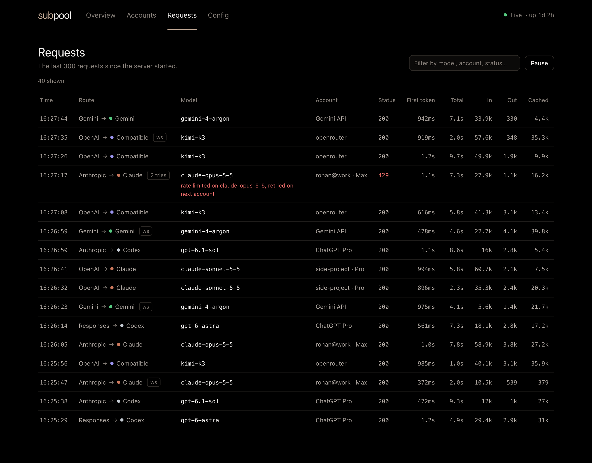

<div align="center">


# subpool

**Your Claude, ChatGPT and Gemini subscriptions. One fast API.**

A single Rust binary that exposes OpenAI, Anthropic and Gemini compatible endpoints, backed by the accounts you already pay for.<br>
Point Claude Code, Codex, your editor or any SDK at one URL and stop caring which account answers.

**Running more than one AI subscription? Use this setup, or copy it for yourself.**<br>
**All I ask is a ⭐ on the repo if you think it's worth it.**

[](https://github.com/rohan-patnaik/subpool/actions/workflows/ci.yml)
[](LICENSE)
[](https://www.rust-lang.org)
[](#why-subpool)
[](#the-dashboard)

[Quick start](#quick-start) · [Connect your tools](#connect-your-tools) · [Dashboard](#the-dashboard) · [Configuration](#configuration) · [FAQ](#faq)

</div>

<br>



<br>

## Why subpool

- **One small binary.** About 7 MB with the dashboard inside, around 11 MB of memory in our tests. No Docker, no Node, no runtime to install.
- **Any model from any tool.** Use GPT inside Claude Code, Claude inside Codex, or Gemini behind the OpenAI SDK. Requests are translated between formats automatically. When the client and the provider already speak the same format, the request passes through untouched.
- **WebSockets.** Codex WebSocket sessions are relayed to ChatGPT's own WebSocket upstream, so `previous_response_id` works on the server side. Switch to a Claude or Gemini model mid-session and Subpool carries the conversation over.
- **Many accounts, no babysitting.** Requests rotate across accounts (round-robin or fill-first). A rate limit cools down only that model on that account, until the reset time the provider reports. Failed requests move to the next account, and OAuth tokens refresh themselves.
- **A dashboard you'll actually open.** Black canvas, warm grays and one tan accent, live over WebSocket: traffic, account health with countdown timers, sign-in flows, a request log and a config editor.
- **Drop-in for CLIProxyAPI users.** Credentials use the same file format. Set `auth-dir: "~/.cli-proxy-api"` and your existing logins work on first start.

## Quick start

**1. Get the binary.** Download it for macOS, Linux or Windows from [Releases](https://github.com/rohan-patnaik/subpool/releases/latest), or build it with Rust 1.88 or newer:

```sh
cargo install --git https://github.com/rohan-patnaik/subpool
```

**2. Start it.**

```sh
subpool
```

The first run writes a commented `config.yaml` in the current directory and serves everything on `http://127.0.0.1:8317`. That address is also the dashboard.

**3. Add an account.** Click **Sign in with Claude** or **Sign in with ChatGPT** in the dashboard, or use the terminal:

```sh
subpool login claude    # Claude Pro / Max
subpool login codex     # ChatGPT Plus / Pro / Team
```

API keys (Anthropic, OpenAI, Gemini, OpenRouter, Ollama, …) can be added from the dashboard or in `config.yaml`.

## Connect your tools

**Claude Code**

```sh
export ANTHROPIC_BASE_URL=http://127.0.0.1:8317
export ANTHROPIC_AUTH_TOKEN=<one of your api-keys, or anything if you set none>
claude
```

Want GPT in Claude Code? `export ANTHROPIC_MODEL=gpt-6-astra`.

**Codex** in `~/.codex/config.toml`

```toml
model = "gpt-6-astra"
model_provider = "subpool"

[model_providers.subpool]
name = "Subpool"
base_url = "http://127.0.0.1:8317/v1"
wire_api = "responses"
env_key = "SUBPOOL_KEY"   # only needed if you set api-keys
```

**OpenAI SDK**, or any tool with a custom OpenAI base URL

```python
from openai import OpenAI

client = OpenAI(base_url="http://127.0.0.1:8317/v1", api_key="<key>")
client.chat.completions.create(
    model="claude-sonnet-5-5",
    messages=[{"role": "user", "content": "Hello"}],
)
```

**curl**

```sh
curl http://127.0.0.1:8317/v1/messages \
  -H "x-api-key: <key>" -H "content-type: application/json" \
  -d '{"model": "gemini-3.8-flash", "max_tokens": 512, "messages": [{"role": "user", "content": "Hello"}]}'
```

### Endpoints

| Endpoint | Speaks |
| --- | --- |
| `POST /v1/chat/completions` | OpenAI Chat Completions |
| `POST /v1/responses` · `GET /v1/responses` (WebSocket) | OpenAI Responses |
| `POST /backend-api/codex/responses` (+ WebSocket) | Codex's native path |
| `POST /v1/messages` · `POST /v1/messages/count_tokens` | Anthropic Messages |
| `POST /v1beta/models/{model}:generateContent` · `:streamGenerateContent` | Gemini |
| `GET /v1/models` · `GET /v1beta/models` | Model lists |

Clients authenticate with `Authorization: Bearer`, `x-api-key`, `x-goog-api-key` or `?key=`.

### Providers

| Provider | Sign-in | Models |
| --- | --- | --- |
| Claude | OAuth (Pro / Max) or API key | `claude-*` |
| Codex / ChatGPT | OAuth (Plus / Pro / Team) or OpenAI API key | `gpt-*`, `o*`, `codex-*` |
| Gemini | API key | `gemini-*` |
| OpenAI-compatible | API key or none (OpenRouter, Ollama, LM Studio, vLLM, …) | whatever you list, with optional aliases |

### Reasoning effort, from the model name

Append an effort level or a token budget to any model:

```text
gpt-6-astra(high)                  effort level
claude-opus-5-5(max)               adaptive thinking at max effort
claude-sonnet-4-5-20250929(16000)  thinking budget in tokens
gemini-2.5-pro(0)                  thinking off
```

## The dashboard

Everything is served from the binary at `/`, with no external requests.

<table>
<tr>
<td width="50%" valign="top"></td>
<td width="50%" valign="top"></td>
</tr>
<tr>
<td valign="top"><b>Accounts:</b> token expiry, cooldown timers per model, usage, and one-click enable, refresh or remove.</td>
<td valign="top"><b>Requests:</b> every request as it happens, showing which client format went to which provider, time to first token, and tokens.</td>
</tr>
</table>

<sub>Screenshots use sample data.</sub>

## Configuration

`config.yaml` reloads automatically when it changes, and the dashboard edits the same file.

```yaml
host: "127.0.0.1"             # 0.0.0.0 to expose it (set api-keys first)
port: 8317
auth-dir: "~/.subpool"        # OAuth credential files (~/.cli-proxy-api reuses CLIProxyAPI logins)
api-keys: ["sk-pick-anything"] # keys your clients must send; empty = open
management-key: ""            # empty = dashboard only from localhost
proxy-url: ""                 # optional http://, https:// or socks5:// upstream proxy
request-retry: 3              # accounts to try before giving up
routing: round-robin          # or fill-first
codex-websockets: true        # native WebSocket relay to ChatGPT
claude-code-mode: true        # send requests on Claude OAuth accounts in Claude Code's request shape

claude-api-key:
  - api-key: "sk-ant-..."
codex-api-key:
  - api-key: "sk-..."
gemini-api-key:
  - api-key: "AIza..."
openai-compatibility:
  - name: openrouter
    base-url: "https://openrouter.ai/api/v1"
    api-keys: ["sk-or-..."]
    models:
      - name: "moonshotai/kimi-k3"
        alias: "kimi-k3"
  - name: ollama
    base-url: "http://127.0.0.1:11434/v1"
    models:
      - name: "qwen3-coder:30b"
```

### Running it on a server

Set `host: "0.0.0.0"`, an `api-keys` entry for your clients, and a `management-key` for the dashboard. Then keep it running, for example with systemd:

```ini
# /etc/systemd/system/subpool.service
[Unit]
Description=Subpool
After=network-online.target

[Service]
ExecStart=/usr/local/bin/subpool --config /etc/subpool/config.yaml
Restart=always

[Install]
WantedBy=multi-user.target
```

To sign in accounts on a server, open the dashboard, click **Sign in**, approve in your browser, then paste the `localhost` URL the browser lands on (it won't load, which is expected). `subpool login claude` on the server works the same way.

## How it works

```text
client request ──parse──▶ shared request model ──build──▶ provider request ──▶ upstream
client stream  ◀─render── shared event stream  ◀─parse─── provider stream  ◀──┘
```

Each wire format (`src/formats/{chat,responses,claude,gemini}.rs`) knows how to parse requests, build requests, decode streams and render streams. Adding a format means writing four functions instead of a translator for every pair.

| File | What it does |
| --- | --- |
| `src/proxy.rs` | Picks an account, translates, retries on the next account, streams back, records usage |
| `src/ws.rs` | Responses over WebSocket: native Codex relay, or local history for other providers |
| `src/upstream.rs` | Per-provider URLs and headers, including the request shape Claude OAuth accounts expect |
| `src/accounts.rs` | Credential files, API keys, routing and cooldowns |
| `src/oauth.rs` | PKCE sign-in and token refresh for Claude and ChatGPT |
| `ui/` | The dashboard: plain HTML, CSS and JS, compiled into the binary |

## Compared with CLIProxyAPI

subpool is a smaller Rust take on [CLIProxyAPI](https://github.com/router-for-me/CLIProxyAPI), not a port.

| | subpool | CLIProxyAPI |
| --- | --- | --- |
| Language | Rust, one binary | Go |
| Dashboard | Built in | Separate web panel |
| Codex WebSockets | Yes, native relay | Yes |
| Claude, Codex, Gemini API keys, OpenAI-compatible | Yes | Yes |
| Antigravity, Vertex, Kimi, xAI, Meta, Devin sign-in | No | Yes |
| Image and video endpoints, plugins, Redis | No | Yes |
| Credential files | Reads and writes CLIProxyAPI's format | — |

Kimi and xAI API keys already work through `openai-compatibility`, since both providers offer OpenAI-compatible APIs. Only their subscription sign-ins are missing.

## FAQ

**Is this allowed?** Subpool is not affiliated with Anthropic, OpenAI or Google. Using subscription accounts through third-party tools may be against a provider's terms, and providers can rate-limit or suspend accounts. You are responsible for how you use it.

**Where are my credentials stored?** In `auth-dir` (`~/.subpool` by default), one JSON file per account, written with `0600` permissions. Nothing leaves your machine except requests to the providers you use.

**Does it phone home?** No. There is no telemetry and the dashboard loads no external assets.

**Claude sign-in fails or gets blocked.** Some Anthropic endpoints sit behind bot protection that CLIProxyAPI works around with a browser TLS fingerprint. Subpool uses standard rustls. If token exchange fails for you, please open an issue with the error from the dashboard.

**Are usage stats saved?** They're kept in memory and reset when Subpool restarts.

## Development

```sh
cargo test            # translator and protocol tests
cargo clippy --all-targets
cargo run -- --config dev.yaml
```

The dashboard lives in `ui/` and is embedded with `include_str!`, so rebuild after editing it.

## License

[Unlicense](LICENSE): public domain. Copy it, change it, sell it, ship it, no attribution required.

## Credits

subpool started from [IuCC123/CLIProxyAPI-Rust](https://github.com/IuCC123/CLIProxyAPI-Rust) (Unlicense), itself inspired by [CLIProxyAPI](https://github.com/router-for-me/CLIProxyAPI). The dashboard palette is borrowed from [slopalytics.com](https://slopalytics.com).

<br>

<div align="center"><sub>If subpool saves you a few subscriptions' worth of juggling, a ⭐ helps others find it.</sub></div>
